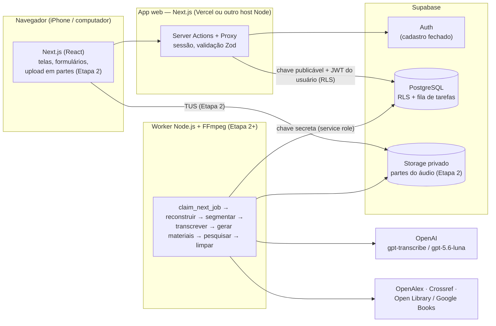
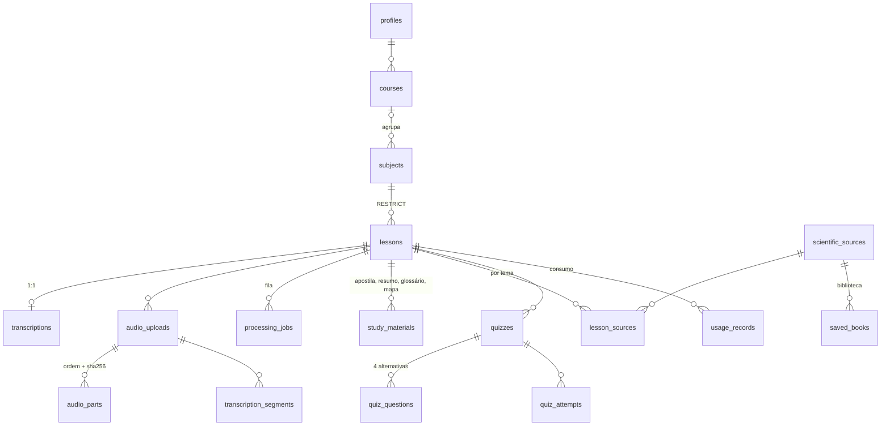

# StudyFlow AI — Arquitetura

Documento técnico de referência. Descreve as decisões tomadas, o modelo de dados,
os serviços externos, custos e a ordem de implementação.

## 1. Visão geral e justificativas



| Decisão | Justificativa |
| --- | --- |
| **Dois componentes**: app web (Next.js) e worker (Node.js) | Uma aula de 4 h leva dezenas de minutos para transcrever; isso não cabe numa requisição HTTP nem em funções serverless. O worker roda em segundo plano, independente do navegador. |
| **Supabase** (Auth + PostgreSQL + Storage) | Um único serviço gerenciado, com plano gratuito, cobre autenticação, banco relacional com RLS e armazenamento privado com upload TUS recuperável. |
| **Fila de tarefas no próprio PostgreSQL** (`processing_jobs`) | Para um único usuário, `SELECT … FOR UPDATE SKIP LOCKED` dá reserva atômica, retentativas e retomada sem Redis ou serviços adicionais. |
| **Server Actions** em vez de API REST própria | Menos código: validação Zod no servidor, sessão em cookies HTTP-only e proteção CSRF nativa do Next.js. |
| **RLS + privilégios por coluna + FKs compostas** | Segurança no banco, não só na interface. Mesmo com uma falha no app, um usuário não lê nem referencia dados de outro. |
| **`cacheComponents` desativado** | Todo o conteúdo é privado e dinâmico; o modelo clássico é mais simples e evita leituras de sessão fora de `<Suspense>`. |
| **Inter servida localmente** (`@fontsource-variable/inter`) | O build não depende do Google Fonts. |
| **Status em `text` + `CHECK`** (não `ENUM`) | Evolui com migrações simples. |
| **Tipos TypeScript gerados do banco real** | `src/lib/supabase/database.types.ts` é gerado a partir das migrações e um teste falha se divergir. |

## 2. Estrutura de pastas

```
.
├── docs/                      # Documentação técnica (este arquivo)
├── scripts/
│   ├── create-user.mjs        # Autoriza o e-mail e cria a conta pessoal
│   ├── test-db.mjs            # Sobe PostgreSQL temporário e roda testes de banco
│   ├── e2e/run.mjs            # Build isolado + Playwright
│   └── lib/db-types.mjs       # Gerador de tipos a partir do catálogo do PostgreSQL
├── src/
│   ├── app/                   # Rotas (App Router)
│   │   ├── login/             # Tela 1 — login + Server Actions de auth
│   │   └── (app)/             # Área privada (layout exige sessão autorizada)
│   │       ├── page.tsx       # Tela 2 — Dashboard
│   │       ├── disciplinas/   # Tela 3 — Disciplinas (+ cursos)
│   │       ├── aulas/         # Aulas, visualização e edição da transcrição (Tela 6)
│   │       └── importar/      # Importar transcrição (Tela 4 recebe o áudio na Etapa 2)
│   ├── components/            # UI (ui/), formulários (forms/), shell e navegação
│   ├── lib/                   # Código puro e compartilhável com o worker
│   │   ├── auth/              # allowlist, redirecionamento seguro, sessão
│   │   ├── supabase/          # clientes (servidor/proxy) e tipos gerados
│   │   ├── text/              # decodificação/normalização de transcrições
│   │   └── validation/        # esquemas Zod
│   ├── server/                # Camada de acesso a dados (server-only, sob RLS)
│   └── proxy.ts               # Renova a sessão e protege rotas (antigo middleware)
├── supabase/
│   ├── config.toml            # Supabase CLI (opcional)
│   └── migrations/            # Migrações SQL versionadas
├── tests/
│   ├── unit/                  # Vitest — lógica pura, proxy e login (Supabase simulado)
│   ├── db/                    # Vitest — PostgreSQL real: RLS, RPCs, fila, tipos
│   └── e2e/                   # Playwright — interface contra Supabase simulado
└── worker/                    # (Etapa 2) processamento assíncrono
```

## 3. Serviços externos

| Serviço | Uso | Etapa | Custo |
| --- | --- | --- | --- |
| Supabase | Auth, PostgreSQL, Storage | 1 | Gratuito até 500 MB de banco, 1 GB de storage, objeto de até 50 MB. Projetos gratuitos **pausam após ~7 dias sem uso** (reativação manual no painel). Pro: US$ 25/mês. |
| Vercel (ou outro host Node) | Site Next.js | 1 | Hobby gratuito para uso pessoal. Limite de **4,5 MB por requisição** (o app limita textos a 4 MB). |
| OpenAI | Transcrição (`gpt-transcribe`) e geração (`gpt-5.6-luna`) | 2–3 | Pago por uso; ver §7. |
| OpenAlex | Descoberta de literatura | 4 | Gratuito (informe e-mail de contato). |
| Crossref | Conferência de DOI/metadados, retratações | 4 | Gratuito (informe e-mail de contato). |
| Open Library / Google Books | Livros | 4 | Gratuito (Google Books: chave opcional com cota diária). |
| Host do worker | Processamento contínuo | 2 | Computador pessoal (grátis, mas precisa estar ligado) ou VM/contêiner pequeno (≈ US$ 5/mês). |

## 4. Variáveis de ambiente

Veja `.env.example` (todas comentadas). Resumo:

| Variável | Onde | Etapa |
| --- | --- | --- |
| `NEXT_PUBLIC_SUPABASE_URL`, `NEXT_PUBLIC_SUPABASE_PUBLISHABLE_KEY` | site | 1 |
| `ALLOWED_EMAILS`, `APP_TIMEZONE` | site | 1 |
| `SUPABASE_SECRET_KEY` | scripts locais, worker | 1 (setup) / 2 |
| `OPENAI_API_KEY`, `OPENAI_TRANSCRIPTION_MODEL`, `OPENAI_TEXT_MODEL`, `OPENAI_TEXT_MODEL_FALLBACK` | worker | 2–3 |
| `ACADEMIC_CONTACT_EMAIL`, `GOOGLE_BOOKS_API_KEY` | worker | 4 |
| `MONTHLY_BUDGET_USD`, `MAX_AUDIO_HOURS_PER_MONTH`, `MAX_LESSONS_PER_MONTH`, `MAX_RESEARCH_TOPICS_PER_LESSON`, `MAX_SOURCES_PER_TOPIC`, `AUTO_DELETE_AUDIO`, `AUDIO_RETENTION_HOURS`, `PRICE_*` | worker (e site para exibição) | 2+ |

A chave secreta **nunca** é usada no navegador: `getPublicSupabaseEnv()` recusa uma chave `sb_secret_` e o site só usa a chave publicável com o JWT do usuário.

## 5. Modelo de dados

Todas as tabelas ficam no schema `public`, com `user_id`, timestamps e RLS.
Relações entre tabelas do usuário usam **chaves estrangeiras compostas `(id, user_id)`**,
impedindo referências cruzadas entre contas mesmo com UUIDs conhecidos.



| Tabela | Conteúdo | Escrita pelo usuário |
| --- | --- | --- |
| `allowed_emails` | Lista de e-mails autorizados; gatilho em `auth.users` bloqueia contas fora dela | Não (só service role) |
| `profiles` | Preferências (exclusão de áudio, retenção, limites); criado por gatilho | Colunas de preferência |
| `courses`, `subjects` | Cursos e disciplinas; `subjects.keywords` = vocabulário científico | Sim |
| `lessons` | Aula; `status` controlado pelo sistema | Título, data, disciplina, observações |
| `transcriptions` | `original_text` **imutável** (gatilho) + `edited_text` revisável; contagens e SHA-256 | Só `edited_text` |
| `audio_uploads`, `audio_parts` | Envio em partes (ordem, tamanho, SHA-256), retenção e relatório de limpeza | Não (RPCs na Etapa 2) |
| `transcription_segments` | Resultado de cada trecho; permite retomar sem repetir segmentos concluídos | Não |
| `processing_jobs` | Fila: estados, tentativas, espera exponencial, heartbeat, uma tarefa ativa por aula/tipo | Não (pedido de nova tentativa via RPC) |
| `study_materials` | JSON tipado (Zod) por tipo de material + versão do prompt e hash da transcrição usada | Não |
| `scientific_sources`, `lesson_sources` | Apenas registros retornados por APIs reais; `evidence_level` = metadata / abstract / full_text; retratação/correção | Não |
| `saved_books` | Biblioteca pessoal (livros e publicações) | Sim |
| `quizzes`, `quiz_questions`, `quiz_attempts` | Simulado e tentativas (correção calculada no banco) | Não diretamente |
| `usage_records` | Minutos de áudio, tokens, chamadas, custo **estimado** e tarifa usada | Não |

Funções SQL:

| Função | Quem executa | Finalidade |
| --- | --- | --- |
| `import_transcription(...)` | usuário autenticado | Cria a aula (se preciso) e grava a transcrição numa transação, validando a posse |
| `request_job_retry(job_id)` | usuário autenticado | Reabre uma tarefa própria que falhou |
| `enqueue_job`, `claim_next_job`, `heartbeat_job`, `complete_job`, `fail_job` | somente service role (worker) | Fila persistente |

## 6. Ordem de implementação

1. **Fundação (concluída):** configuração, autenticação fechada, banco completo com RLS, dashboard, disciplinas/cursos, aulas, importação de TXT/texto, visualização e edição da transcrição.
2. **Áudio:** bucket privado + políticas; upload TUS em partes de ~20 MB com SHA-256; RPCs de upload; worker (fila, FFmpeg, segmentos de ~10 min, `gpt-transcribe` com vocabulário da disciplina como `prompt`); consolidação com verificação de integridade; exclusão segura; tela de Processamento; Configurações.
3. **Materiais:** pipeline hierárquico (segmentos → tópicos → consolidação → verificação), saídas validadas por Zod, apostila/resumo/glossário/mapa mental/5 questões, impressão.
4. **Pesquisa científica:** OpenAlex + Crossref + Open Library/Google Books, validação de metadados, cache de consultas, separação aula × complementação, biblioteca.
5. **Estabilização:** testes com credenciais reais, áudio de 4 h, Safari no iPhone, consumo, revisão de segurança, documentação de implantação.

## 7. Custos estimados e limitações

Estimativas para orientação — **confirme as tarifas atuais** nas páginas oficiais; o app
registra o custo sempre como estimativa configurável (`PRICE_*`).

- **Transcrição:** proporcional à duração. Com uma tarifa de referência de US$ 0,006/min, 4 h ≈ US$ 1,44. A tarifa do `gpt-transcribe` deve ser confirmada.
- **Geração de materiais (`gpt-5.6-luna`)**, reportado em US$ 0,20 / 1,20 por milhão de tokens (entrada/saída): uma aula de 4 h (~65 mil tokens) processada hierarquicamente (~200 mil tokens de entrada e ~30 mil de saída) ≈ US$ 0,08.
- **Pesquisa acadêmica:** gratuita (limites de taxa das APIs).
- **Supabase/Vercel:** gratuitos no uso pessoal, com as ressalvas da §3.

Limitações relevantes:

- A API de transcrição aceita arquivos de até 25 MB: o worker sempre segmenta e recomprime (mono, taxa de bits baixa).
- O plano gratuito do Supabase limita cada objeto a 50 MB: por isso o upload é dividido em partes no navegador.
- Um worker no computador pessoal só processa enquanto o computador estiver ligado e conectado.
- A verificação automática da transcrição é de **integridade** (todos os segmentos presentes e salvos), não garantia de que cada palavra foi reconhecida corretamente.
- Localizar os metadados de um artigo não comprova suas conclusões; o app diferencia metadados, resumo consultado e texto completo analisado.
